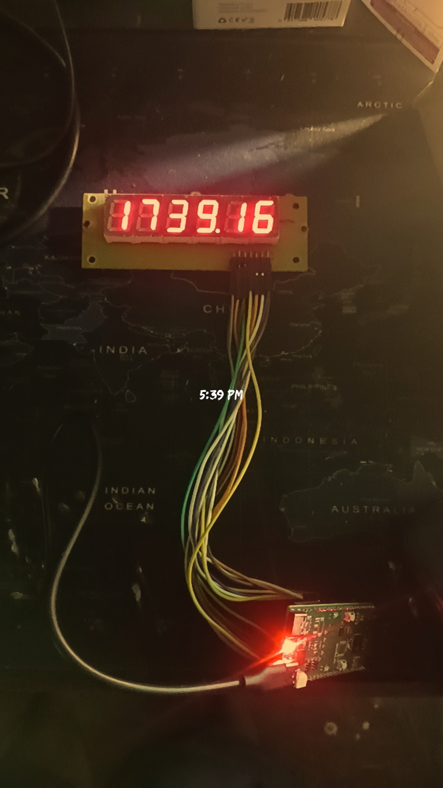
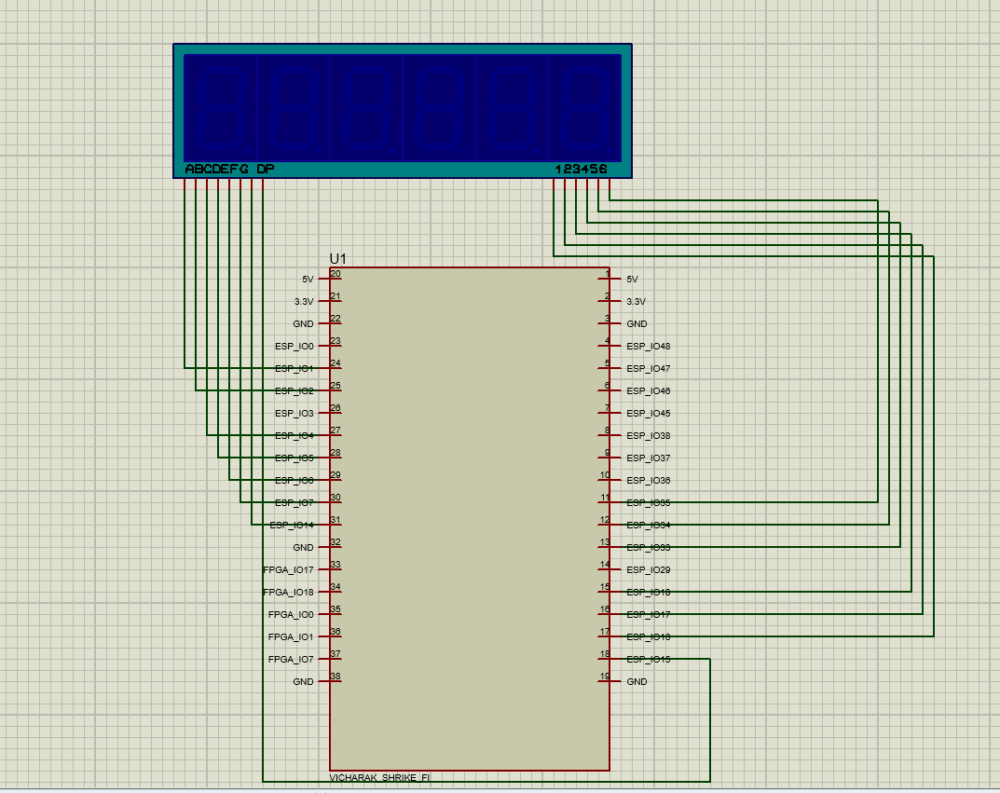

# ShrikeClock

A MicroPython-based digital clock built on a common-anode 6-digit 7-segment
display, driven by a Vicharak Shrike-Fi (ESP32-S3) board. Syncs real time
over WiFi using NTP, and auto-toggles between time and date display.




## Features

- Multiplexed driver for a 14-pin (8 segment + 6 digit) common-anode display
- WiFi connection + NTP time sync (auto-resyncs every 1 hour)
- Configurable timezone offset (default: IST, UTC+5:30)
- Boot-up segment chase animation
- Auto-toggles: shows time (HH:MM:SS with blinking colon) for 8s,
  then date (DD.MM.YY) for 2.5s, on a loop
- Flicker-free continuous multiplexing (non-blocking design)

## Hardware

- **Board:** Vicharak Shrike-Fi (ESP32-S3 + FPGA)
- **Display:** 6-digit, 14-pin, common-anode 7-segment module

### Circuit Diagram



### Pin Mapping

| Signal | GPIO |
|--------|------|
| Segment a | 1 |
| Segment b | 2 |
| Segment c | 4 |
| Segment d | 5 |
| Segment e | 6 |
| Segment f | 7 |
| Segment g | 14 |
| Segment dp | 15 |
| Digit 1 | 16 |
| Digit 2 | 17 |
| Digit 3 | 18 |
| Digit 4 | 33 |
| Digit 5 | 34 |
| Digit 6 | 35 |

**Avoided pins on Shrike-Fi:** GPIO 8, 9, 10, 11, 12, 13 (FPGA bus),
GPIO 21 (onboard LED), GPIO 0/3/45/46 (strapping), GPIO 19/20 (USB).

## Setup

1. Flash MicroPython firmware onto the Shrike-Fi (ESP32-S3).
2. Copy `main.py` onto the board (e.g. via `ampy`, `rshell`,
   or Thonny). It will auto-run on boot.
3. Open the file and edit the config section near the top:
   ```python
   WIFI_SSID = "YOUR_WIFI_SSID"
   WIFI_PASSWORD = "YOUR_WIFI_PASSWORD"
   TZ_OFFSET_HOURS = 5.5   # change if not in IST
   ```
4. Wire the display according to the pin mapping table above.
5. Power on / run the script. Boot animation plays, then the board
   connects to WiFi, syncs time via NTP, and starts the clock.

## Usage Notes

- `SHOW_TIME_MS` and `SHOW_DATE_MS` (in the main loop) control how long
  each mode is displayed — adjust for faster/slower toggling.
- `RESYNC_EVERY_MS` controls how often the clock re-syncs with the NTP
  server (default: 3,600,000 ms = 1 hour).
- If WiFi fails to connect within 15 seconds, the script raises a
  `RuntimeError`  double-check SSID/password.

## Author

**Kritish Mohapatra**

## Known Constraints

- MicroPython's `str` type has no `.rjust()`, padding is done manually.
- GPIO33–37 are used for octal SPI flash/PSRAM on some ESP32-S3 modules;
  confirmed working on this board's module variant, but worth keeping
  in mind if pins are ever reassigned.